# Novus — guía rápida para la demo

## Capturas

| Inicio | Vender |
|---|---|
| 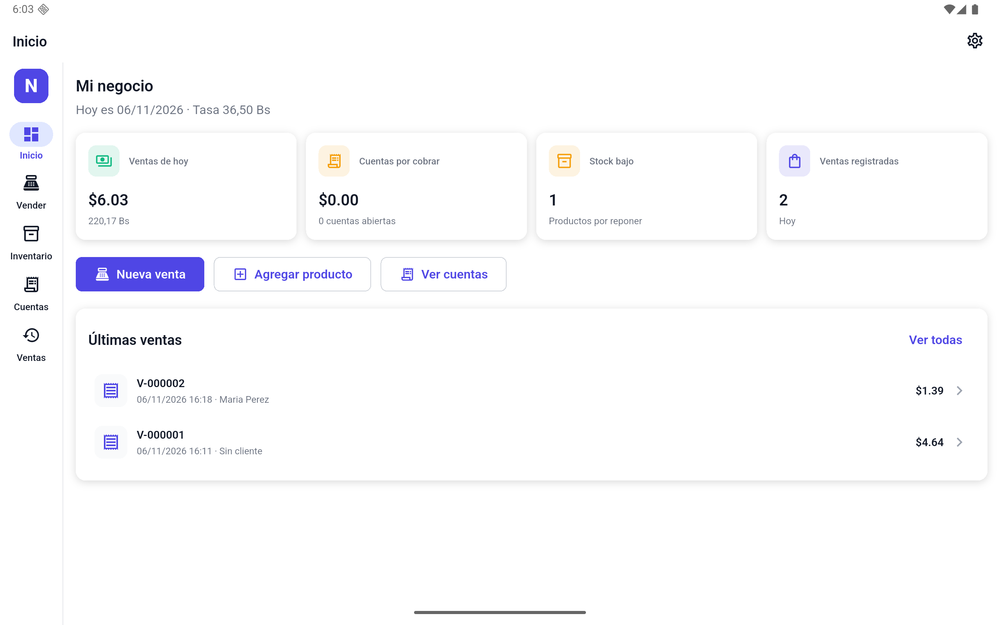 | 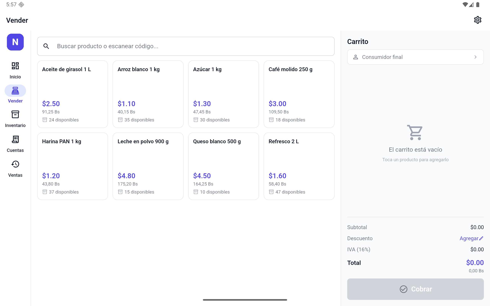 |

| Inventario | Cuentas por cobrar |
|---|---|
| 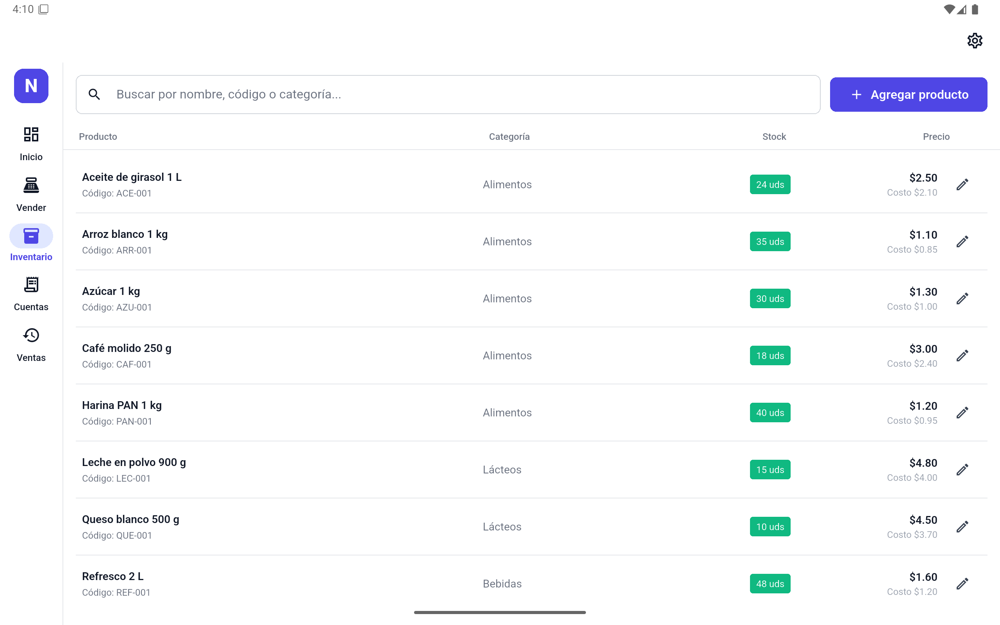 | 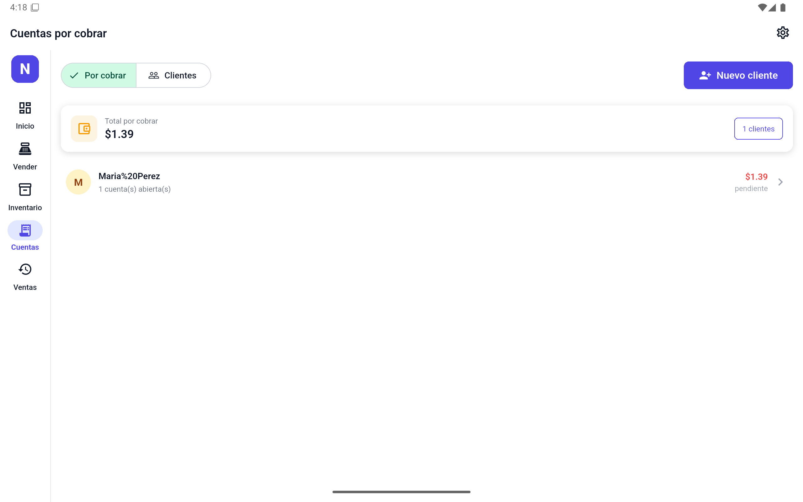 |

| Nota de entrega (PDF) | Primer arranque |
|---|---|
| 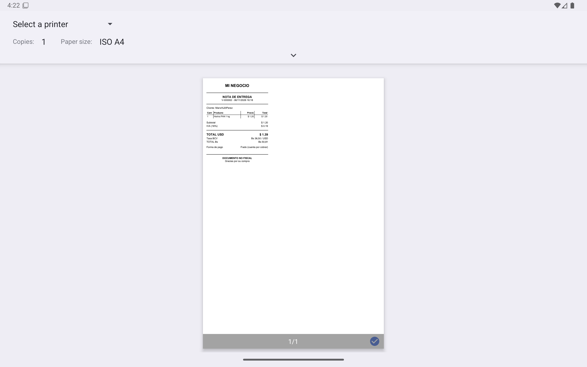 | 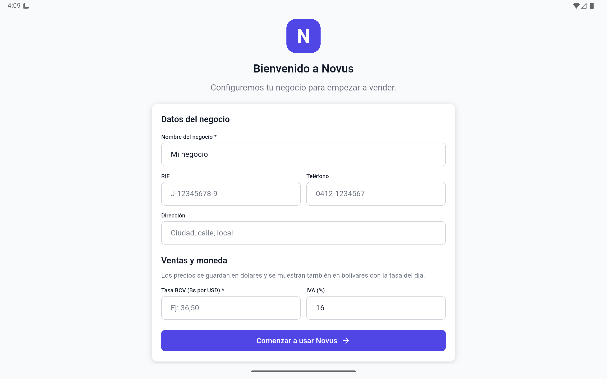 |

| Cierre de caja | Reportes por fecha |
|---|---|
| 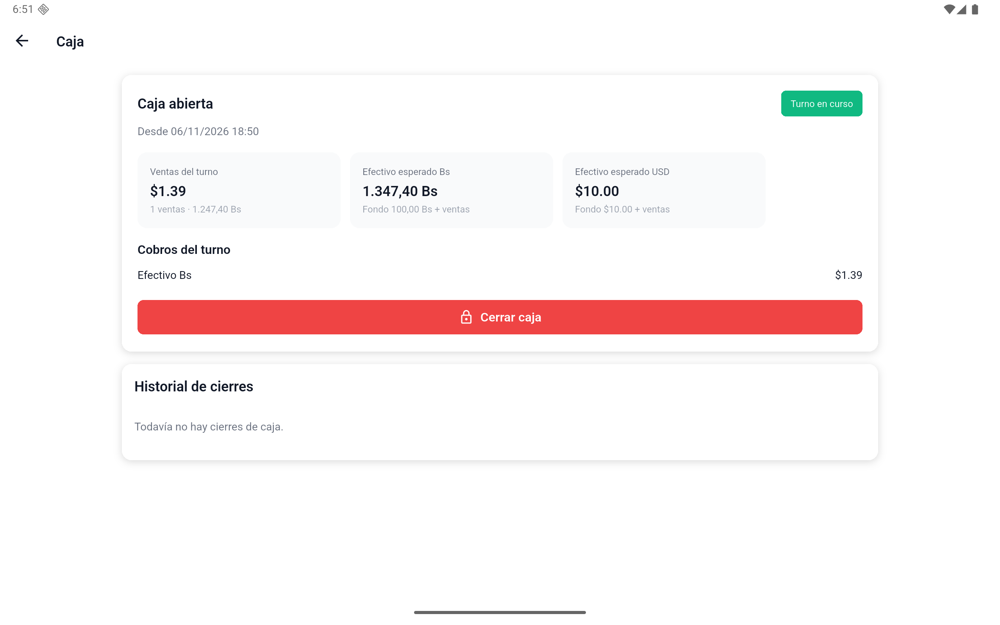 | 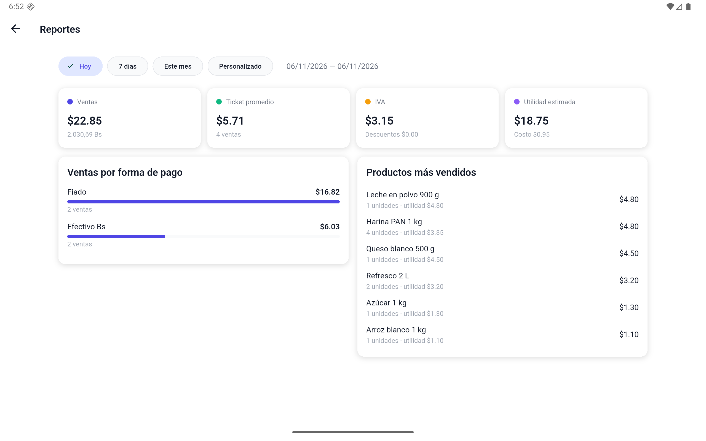 |

| Respaldo | Tasa BCV automática |
|---|---|
| 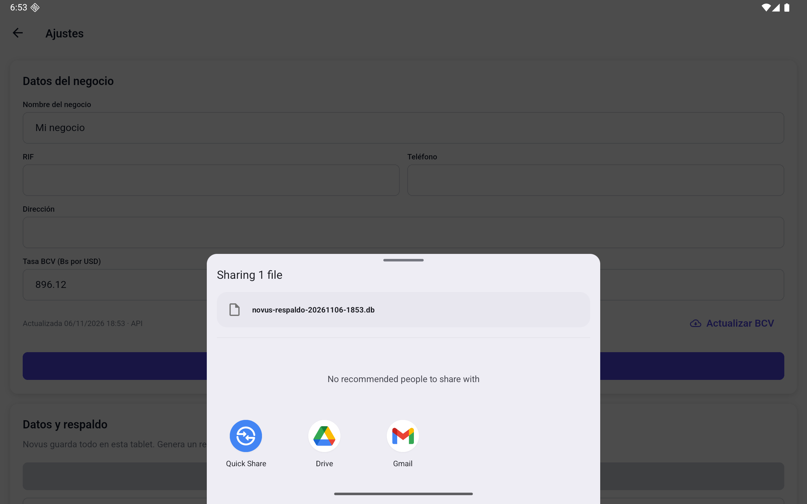 | 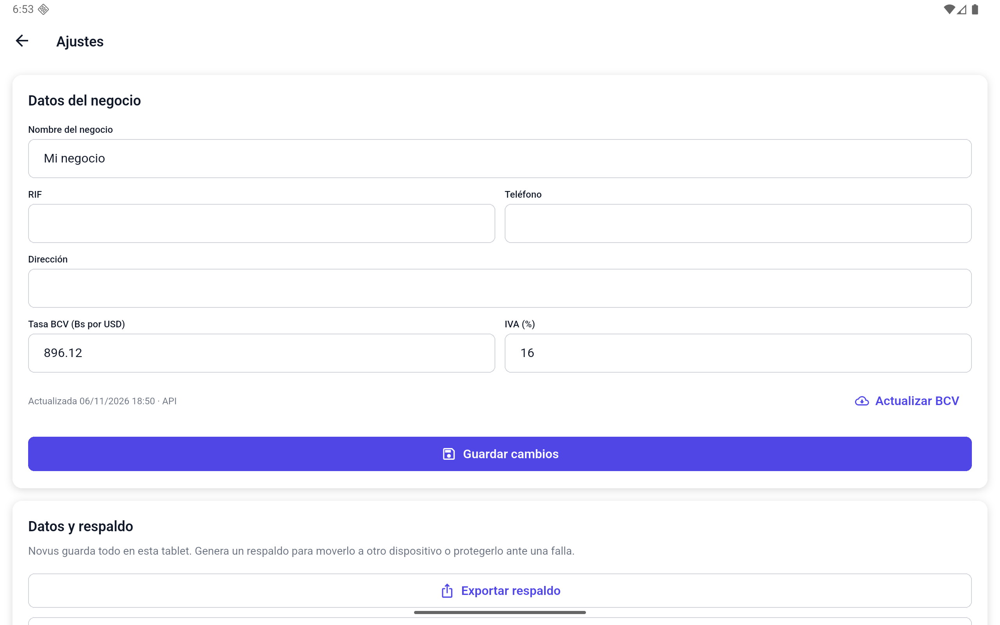 |

| Pago combinado | Detalle de la venta |
|---|---|
| 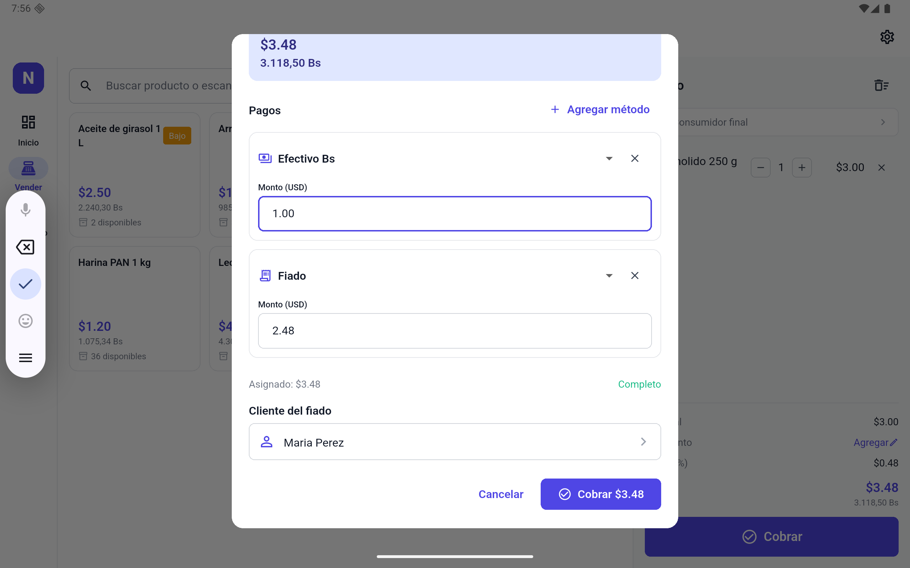 | 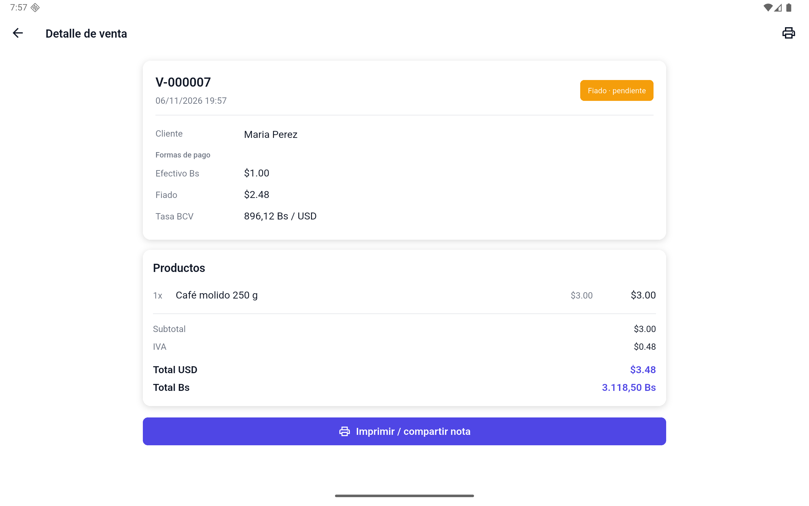 |

| Saldar cuenta | Cuenta pagada |
|---|---|
| 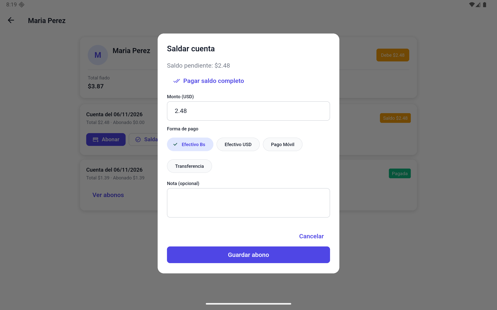 | 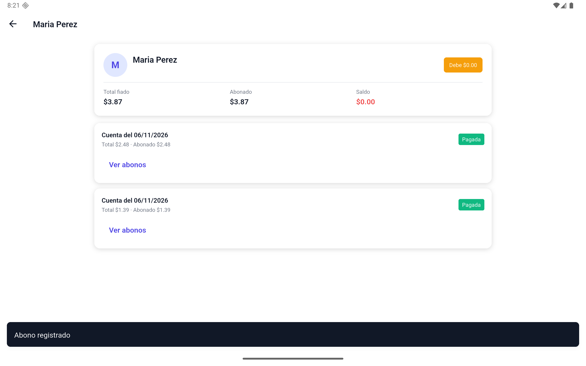 |

## Instalar en la tablet

1. Copia `dist/Novus-1.0.0-tablet.apk` a la tablet (cable USB, Google Drive o
   WhatsApp).
2. Abre el archivo y permite “Instalar apps desconocidas” si Android lo pide.
3. La app aparece como **Novus**.

También puedes instalarla por ADB:

```bash
adb install -r dist/Novus-1.0.0-tablet.apk
```

## Primer arranque

1. Escribe el nombre del negocio (por ejemplo, “Bodega La Esquina”).
2. Opcional: RIF, teléfono y dirección.
3. Introduce la **tasa BCV** del día (Bs por USD). Sin tasa no se muestran los
   montos en bolívares.
4. Deja el IVA en **16** (puedes cambiarlo a 0 si tus precios ya lo incluyen).
5. Pulsa **Comenzar a usar Novus**.

## Recorrido sugerido para la demo

1. **Inventario → Cargar productos de ejemplo**: carga 8 productos típicos.
2. **Vender**: toca productos para agregarlos al carrito. En horizontal verás
   el catálogo a la izquierda y el carrito a la derecha.
3. **Cobrar**: elige un método o pulsa **Agregar método** para combinar
   efectivo, Pago Móvil, transferencia, punto de venta y fiado. Si falta cubrir
   el total, pulsa **Dejar resto fiado** y selecciona el cliente.
4. Si usas **Fiado** (total o parcial), crea/selecciona un cliente. La parte
   fiada queda en **Cuentas**.
5. **Cuentas → cliente → Registrar abono**: registra un pago parcial o total.
   Para cobrar todo el saldo de una vez, usa **Saldar cuenta**.
6. **Cuentas → Nuevo cliente**: puedes fijar un **límite de crédito** en USD.
   Si el cliente lo supera, la app no deja cerrar el fiado.
7. **Ventas → venta → Anular venta**: devuelve el stock, saca la venta de caja y
   reportes, y anula el fiado. No se permite si la cuenta ya tiene abonos.
8. **Ventas → venta → Imprimir / compartir nota**: genera el PDF con la leyenda
   “DOCUMENTO NO FISCAL”.
9. **Inicio → Caja**: abre la caja con el fondo inicial, vende y luego ciérrala
   contando el efectivo en Bs y USD. La diferencia queda en el historial.
10. **Inicio → Reportes**: cambia entre Hoy, 7 días, Este mes o un rango
   personalizado. Verás el total vendido, las ventas registradas y el desglose
   por método de pago (Punto de venta, Efectivo Bs/USD, Pago Móvil,
   transferencia y fiado), además de los productos más vendidos.
11. **Ajustes → Actualizar BCV**: trae la tasa oficial del día. También se
   intenta actualizar sola al abrir la app.
12. **Ajustes → Exportar respaldo**: comparte un archivo `.db` por WhatsApp,
    Drive o correo. **Restaurar respaldo** recupera ese archivo.
13. **Vender → ícono de escanear**: apunta al código de barras y el producto se
    agrega al carrito.
14. **Ajustes → Impresora térmica**: empareja la impresora desde Bluetooth de
    Android, elígela, selecciona 58/80 mm y usa **Imprimir prueba**. Luego, al
    cobrar, aparece **Imprimir ticket**.

## Qué funciona

- Inventario con stock, stock mínimo, búsqueda y edición.
- Carga rápida de productos: categorías sugeridas, SKU automático, aviso de
  código de barras/SKU duplicado y **Guardar y agregar otro**.
- Lector de código de barras con la cámara desde el POS y desde el producto.
- Ventas con IVA configurable, descuento y doble moneda (USD/Bs).
- Anulación de ventas con devolución de stock y anulación del fiado.
- Cuentas por cobrar con abonos, saldo por cliente y límite de crédito.
- Cierre de caja con fondo, efectivo esperado, conteo y diferencia.
- Reportes por rango de fechas con totales por método de pago.
- Impresión de ticket en impresora térmica Bluetooth (ESC/POS, 58/80 mm).
- Respaldo y restauración de la base.
- Tasa BCV automática (BCV oficial, con API de respaldo).
- Nota de entrega/recibo en PDF para imprimir o compartir.
- Inicio con ventas del día, cuentas pendientes y stock bajo.
- Los datos quedan guardados en la tablet; la tasa se actualiza cuando hay conexión.

## Limitaciones de esta versión

- Está pensada para **una sola caja/tablet**.
- No emite facturación fiscal (SENIAT); solo documentos no fiscales.
- La app no tiene bloqueo por PIN ni usuarios/roles.
- La sincronización entre varias cajas queda para una fase posterior.
- No se pueden hacer devoluciones parciales: la anulación es de la venta
  completa y no se permite si la cuenta ya tiene abonos.
- El lector de barras necesita permiso de cámara; la impresora debe ser
  Bluetooth ESC/POS (no USB ni red por ahora).
- El APK es universal (~72 MB, incluye el lector de códigos); se puede dividir
  por arquitectura para reducir el tamaño.

## Firma de la aplicación

El APK de `dist/` está firmado con el keystore `android/novus-release.jks`
(alias `novus`). Las credenciales están en `android/key.properties`, que **no
se sube al repositorio**.

Guarda una copia segura de `android/novus-release.jks` y de
`android/key.properties`: sin ellos no podrás publicar actualizaciones que
conserven los datos instalados.

## Datos de la demo

Los productos de ejemplo son locales y se pueden borrar desde
**Ajustes → Borrar ventas, productos y clientes**.
